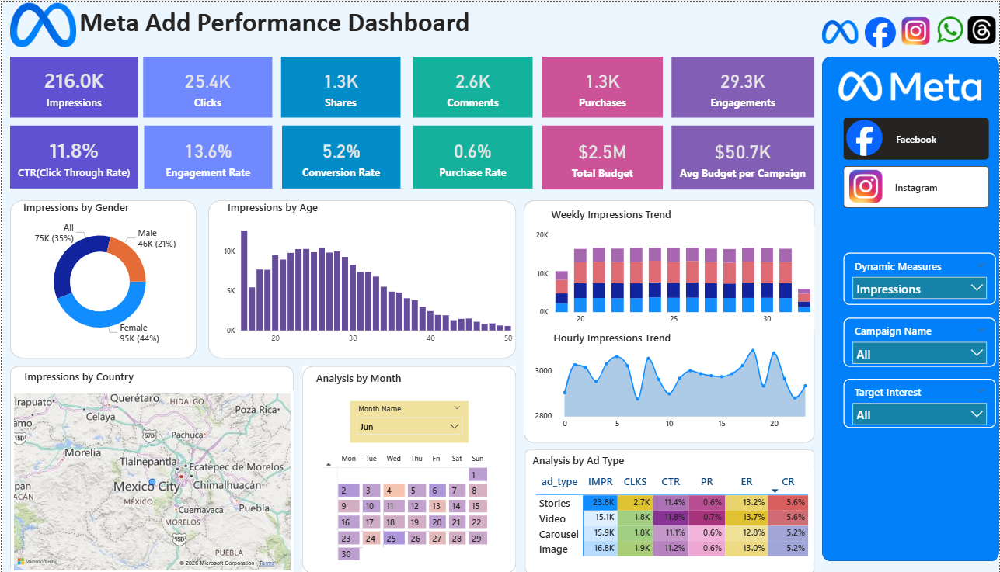
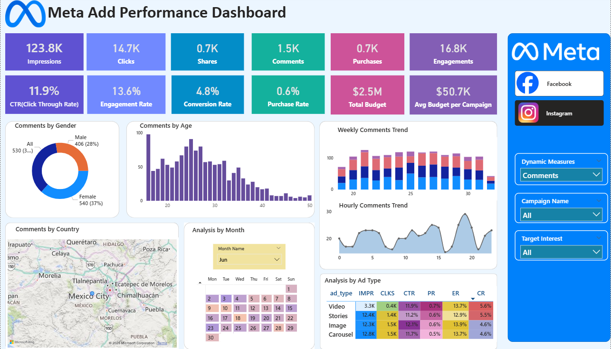

# Meta Ad Performance Analysis Dashboard

An interactive **Power BI** dashboard that tracks paid advertising performance across **Facebook** and **Instagram**. It covers reach, engagement, conversions and budget utilisation, so the marketing team can see which platform, audience, ad format and time slot delivers the best return.

---

## Dashboard Preview

### Facebook


### Instagram


---

## Table of Contents
1. [Business Objective](#business-objective)
2. [Scope](#scope)
3. [Dashboard Overview](#dashboard-overview)
4. [KPIs and Definitions](#kpis-and-definitions)
5. [Visuals](#visuals)
6. [Dataset](#dataset)
7. [Data Model](#data-model)
8. [Key Insights](#key-insights)
9. [Recommendations](#recommendations)
10. [Repository Contents](#repository-contents)
11. [How to Use](#how-to-use)

---

## Business Objective

The business needs a performance tracking report for campaigns running on Facebook and Instagram. The report gives visibility into campaign reach, engagement, conversions and budget utilisation, and helps the marketing team to:

- Identify the most effective platform (Facebook vs Instagram)
- Track campaign ROI and optimise budget allocation
- Understand audience engagement patterns

## Scope

| In scope | Out of scope |
|---|---|
| Paid campaigns on Facebook and Instagram | Other platforms (Messenger, Audience Network) |
| | Organic engagement (paid ads only) |

## Dashboard Overview

The report has three pages:

| Page | Purpose |
|---|---|
| **Facebook** | Full dashboard for Facebook ads |
| **Instagram** | Same layout and measures, for Instagram ads |
| **Calendar Tooltip** | Hidden tooltip page. Hovering over a day in the calendar heat map shows that day's KPIs |

**Interactive controls**
- **Metric selector (slicer):** a dynamic-measure parameter that switches every chart between Impressions, Clicks, Purchases and the other metrics
- **Campaign** slicer
- **Target interests** slicer
- **Month** slicer (calendar)
- Page navigator to switch between Facebook and Instagram

## KPIs and Definitions

All KPIs are DAX measures built from `ad_events` rows, based on `event_type`.

| KPI | Definition | Formula |
|---|---|---|
| Impressions | Times ads were displayed | Count of `event_type = Impression` |
| Clicks | Times users clicked ads | Count of `event_type = Click` |
| Shares | Times ads were shared | Count of `event_type = Share` |
| Comments | User comments on ads | Count of `event_type = Comment` |
| Purchases | Purchases made after seeing ads | Count of `event_type = Purchase` |
| Engagements | Total interactions | Clicks + Shares + Comments |
| CTR (Click Through Rate) | % of impressions that became clicks | (Clicks ÷ Impressions) × 100 |
| Engagement Rate | % of impressions that became engagements | (Engagements ÷ Impressions) × 100 |
| Conversion Rate | % of clicks that became purchases | (Purchases ÷ Clicks) × 100 |
| Purchase Rate | % of impressions that became purchases | (Purchases ÷ Impressions) × 100 |
| Total Budget | Total spend allocated to campaigns | Sum of `campaigns.total_budget` |
| Avg Budget per Campaign | Average budget per campaign | Total Budget ÷ Campaign Count |

## Visuals

Every chart responds to the metric selector.

| # | Visual | Chart type | Fields | Purpose |
|---|---|---|---|---|
| 1 | Target Gender | Donut | `ads.target_gender` | Which gender segment contributes most |
| 2 | Age Group | Column | `users.user_age` | Which age group responds best |
| 3 | Country | Map (bubble) | `users.country` | Geographic reach and engagement |
| 4 | Calendar Month | Calendar heat map (matrix) | `Calendar Table` day name × week number | Seasonal trends, peak and low-activity days |
| 5 | Weekly Trend | Stacked column | Week number, stacked by `ads.ad_type` | Ad type contribution over weeks |
| 6 | Hourly Trend | Area | `ad_events` hour of day (0–23) | Activity pattern across the day |
| 7 | Ad Type | Matrix | `ads.ad_type` with Impressions, Clicks, CTR, Conversion Rate, Purchase Rate, Engagement Rate | Compare ad formats side by side |

The top of each page also shows 12 KPI cards for the measures above.

## Dataset

The data comes from four CSV source files (in the `Raw Data` folder), loaded into Power BI. Two more tables, `Calendar Table` and `Dynamic Measures`, are created inside Power BI.

| File | Description | Key fields used in the report |
|---|---|---|
| `ad_events.csv` | Every ad event (impression, click, share, comment, purchase) | `event_type`, timestamp, `time_of_day` |
| `ads.csv` | Ad details | `ad_type`, `target_gender`, `target_interests` |
| `campaigns.csv` | Campaign details | campaign `name`, `total_budget` |
| `users.csv` | User details | `user_age`, `country` |

## Data Model

Star-schema model with `ad_events` as the central fact table.

| Table | Type | Role |
|---|---|---|
| `ad_events` | Fact | One row per event (impression, click, share, comment, purchase) with timestamp and time of day |
| `ads` | Dimension | Ad type, target gender, target interests |
| `campaigns` | Dimension | Campaign name, total budget |
| `users` | Dimension | User age, country |
| `Calendar Table` | Dimension | Date, day name, day number, week number, month name |
| `Dynamic Measures` | Helper | Disconnected table that powers the metric selector (field parameter) |

Chart titles (Gender, Age, Map, Calendar, Weekly, Hourly, Matrix) are DAX measures, so they update with the selected metric.

## Key Insights

Figures below are taken from the dashboard snapshot in `Documentation/Dashboard_Insights.pdf`.

**Headline numbers**

| Metric | Value | Metric | Value |
|---|---|---|---|
| Impressions | 216K | CTR | 11.76% |
| Clicks | 25.4K | Engagement Rate | 13.56% |
| Shares | 1.3K | Conversion Rate | 5.21% |
| Comments | 2.6K | Purchase Rate | 0.61% |
| Purchases | 1.3K | Total Budget | 2.5M |
| Engagements | 29K | Avg Budget / Campaign | 50.7K |

**Findings**
- **Strong top of funnel, weak bottom.** CTR (11.76%) and engagement rate (13.56%) are very healthy, but only 0.61% of impressions end in a purchase.
- **Audience.** Female users drive 43% of engagement (Male 22%, Other/Not specified 35%). Engagement peaks in the 20–30 age group and falls sharply after 35.
- **Geography.** US, India, Brazil, Germany and the UK contribute most.
- **Timing.** Engagement is steady week to week, peaks in the afternoon and evening (about 15:00–20:00) and is lowest from 00:00 to 05:00. Specific days in June (19th–21st, 25th–27th) spike, likely due to launches or promotions.
- **Ad format.**

| Ad Type | Impressions | Clicks | CTR | Purchase Rate | Conversion Rate | Engagement Rate |
|---|---|---|---|---|---|---|
| Carousel | 48K | 6K | 11.7% | 0.59% | 5.1% | 13.4% |
| Image | 51K | 6K | 11.7% | 0.57% | 4.9% | 13.5% |
| Stories | 72K | 8K | 11.8% | 0.65% | 5.2% | 13.6% |
| Video | 46K | 5K | 11.9% | 0.62% | 5.2% | 13.7% |

Video has the best CTR, conversion and engagement rates. Stories deliver the most impressions and the best purchase rate.

## Recommendations

1. **Fix the purchase funnel.** Improve landing pages, offers and retargeting to lift the purchase rate.
2. **Target the right audience:** females aged 18–30.
3. **Prioritise markets:** India, US and Brazil for volume and engagement; Germany and UK for premium campaigns.
4. **Favour Video and Stories** over Image and Carousel when allocating budget.
5. **Schedule delivery** in the afternoon and evening slots.
6. **Shift budget** towards the best-performing geographies and formats.

## Repository Contents

```
├── Raw Data/
│   ├── ad_events.csv                   # Ad event log
│   ├── ads.csv                         # Ad details
│   ├── campaigns.csv                   # Campaign details
│   └── users.csv                       # User details
├── Documentation/
│   ├── Business_Requirements_Document.pdf  # Objectives, scope, KPI definitions, chart specs
│   └── Dashboard_Insights.pdf              # Findings and recommendations
├── images/
│   ├── facebook-dashboard.png          # Facebook page screenshot
│   └── instagram-dashboard.png         # Instagram page screenshot
├── Meta Ad Analysis.pbix               # Power BI report (model, measures, visuals)
└── README.md
```

## How to Use

1. Install [Power BI Desktop](https://powerbi.microsoft.com/desktop/) (the file was created with the November 2025 release).
2. Open `Meta Ad Analysis.pbix`.
3. Use the **Facebook** and **Instagram** navigator buttons to switch platform.
4. Pick a metric in the metric selector. All charts update together.
5. Narrow the view with the Campaign, Target Interests and Month slicers.
6. Hover over a day in the calendar heat map to see that day's KPIs.
